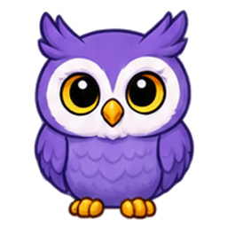
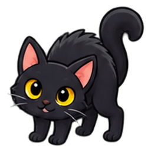
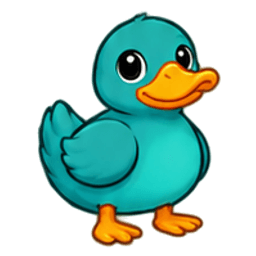
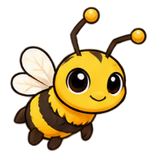
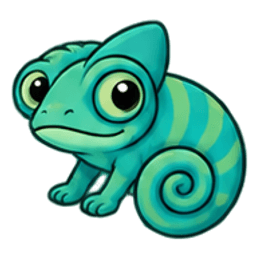
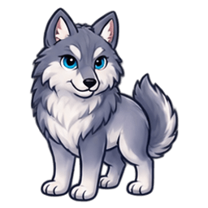
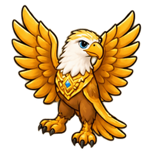
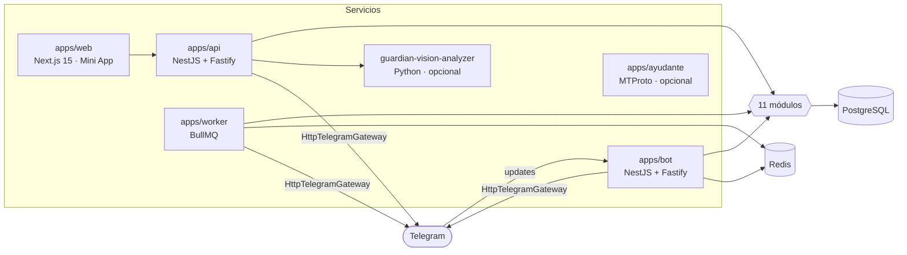
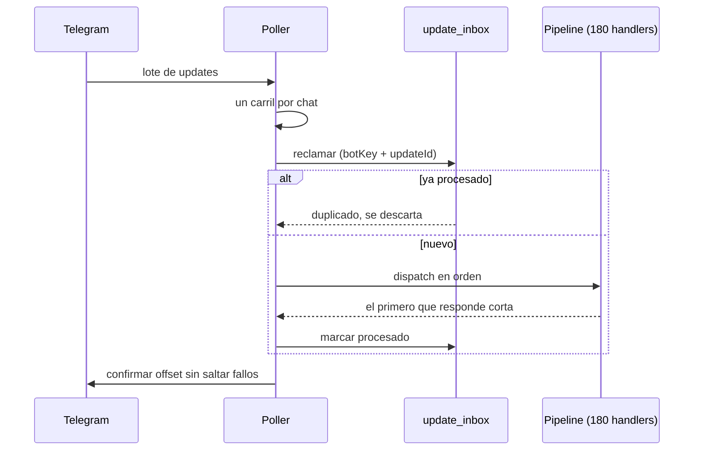

<div align="center">


# Modryva

**Un bot de Telegram para comunidades grandes: moderación, verificación,
economía, casino, mascotas e IA, todo en un mismo bot.**

[](LICENSE)


[Qué hace](#qué-hace) ·
[Mascotas](#las-mascotas) ·
[Arquitectura](#arquitectura) ·
[Decisiones de ingeniería](#decisiones-de-ingeniería) ·
[Puesta en marcha](#puesta-en-marcha)

</div>

---

Modryva nació antes del verano de 2026 como el bot de una comunidad de
Telegram y acabó moderando y entreteniendo a varias a la vez, con **cientos de
personas usándolo cada día**. Cientos de miles de mensajes, miles de robos
entre miembros, decenas de mascotas criadas a mano y un casino que se puede
comprobar tirada a tirada.

En octubre de 2026 se apagó: su creador pasó a dedicar el tiempo y el servidor
a montar su propia empresa. Este repositorio publica el código tal como estaba
el último día, limpio de datos de la comunidad, por si sirve a alguien… y por
si algún día vuelve.

> [!NOTE]
> **Proyecto archivado.** No se aceptan cambios, pero el código compila, pasa
> sus tests y se puede levantar en local con Docker.

## Modryva en cifras

| | |
| --- | --- |
| **~227.000** líneas de TypeScript, sin contar tests | **10.359** tests en verde, en **729** ficheros |
| **11** módulos funcionales | **180** handlers en el pipeline del bot |
| **172** modelos de datos y **50** migraciones | **20** trabajos programados en el worker |
| **39** especies de mascota con sprite propio | **5** aplicaciones y **1** servicio de visión en Python |

## Qué hace

<table>
<tr>
<td width="50%" valign="top">

### 🛡️ Moderación
- Antiflood, captcha y filtros de caracteres y enlaces
- Avisos y sanciones con expiración automática
- Detección de estafas, suplantación y doxxing
- Vigilancia de los admins que nombra el propio bot
- Registro de sanciones y espejo de reportes para el staff

</td>
<td width="50%" valign="top">

### 📸 Guardian
- Verificación de entrada **con cámara** desde la Mini App
- Retos de gestos con alternativa accesible
- Revisión por IA y por el staff, que decide
- Fotos **cifradas en reposo** con clave propia y borradas a las 72 h
- Análisis visual opcional en Python (OpenCV y MediaPipe)

</td>
</tr>
<tr>
<td valign="top">

### 💰 Economía y casino
- Monedas por grupo con **libro mayor**: cada movimiento queda apuntado
- Tienda, inventario, robos, multas y donaciones
- Casino **provably fair**: crash, minas, blackjack y plinko
- Duelos de dados con los dados animados de Telegram
- Alertas de inflación y detección de fraude

</td>
<td valign="top">

### 🐾 Mascotas
- 39 especies en 6 familias, de comunes a legendarias
- Hambre, ánimo, niveles, rachas y evolución
- Eclosión por **commit-reveal**: nadie puede predecir el huevo
- Efectos que tocan los robos, el casino y los duelos
- Su propia pantalla en la Mini App

</td>
</tr>
<tr>
<td valign="top">

### 🤖 IA
- Conversación por mención y por privado
- Personalidad propia y reglas que no se pueden saltar
- Groq, Gemini u OpenRouter, con rotación de claves
- Cuotas por persona y por grupo, y modo degradado
- Memoria por persona, que cada cual borra con `/olvida`

</td>
<td valign="top">

### 🎮 Comunidad y juegos
- Bienvenidas, reglas, presentaciones y rangos
- Trivia, wordle, ahorcado, conecta 4 y El Impostor
- Estadísticas del grupo y rankings
- Publicaciones programadas y recurrentes
- **Panel de configuración** completo en la Mini App

</td>
</tr>
</table>

## Las mascotas

Cada miembro puede criar una mascota en cada grupo. Comen, se aburren,
duermen cuando nadie las cuida (nunca mueren de abandono) y suben de nivel.
Cada especie tiene un efecto que se nota en el resto del bot: el zorro roba
mejor, la tortuga protege de los robos, el pato da suerte en el casino y el
gato negro se queda con los empates de los duelos.

<div align="center">








<br />








</div>

La economía de las mascotas está diseñada para que **cuidarlas cueste más de lo
que devuelven**: son un sumidero de monedas, no una impresora. El rendimiento
diario se paga una sola vez por día gracias a una clave única en el libro
mayor, así que ni reiniciar el worker ni repetir el barrido imprime dinero.

## Arquitectura



Un monorepo pnpm en TypeScript con tres capas:

| Capa | Qué contiene |
| --- | --- |
| **`apps/`** | Los procesos: el bot que recibe updates, la API de la Mini App, la web, el worker y el ayudante opcional |
| **`modules/`** | La lógica de producto en 11 módulos: `core`, `security`, `guardian`, `community`, `support`, `automation`, `files`, `games`, `social`, `ai` y `payments` |
| **`packages/`** | Lo compartido: `domain` (contratos puros), `data` (Prisma y repositorios), `telegram` (gateway y normalización), `auth` (RBAC) y `shared` (entorno, logs y métricas) |

### El ciclo de un update



## Decisiones de ingeniería

Lo que hace que el código sea fiable no está en ninguna función concreta, sino
en propiedades que los tests mantienen a lo largo de todo el repo.

**Fiabilidad del ciclo de updates**
- **Idempotencia por update.** Cada update se reclama una sola vez por bot. Los
  reintentos nunca duplican efectos.
- **El offset nunca salta un update fallido.** Si un handler falla, ese update
  se reintenta con un tope de tres intentos; uno envenenado se descarta en vez
  de congelar el grupo.
- **Orden estricto por chat, paralelismo entre chats.** De ese orden dependen
  los contadores de flood y la moderación, así que nunca hay un `Promise.all`
  del lote entero.
- **Toda promesa se espera.** El lint tiene `noFloatingPromises` en error: una
  promesa sin `await` rompería el orden en silencio.
- **Los nombres de handler son tipos, no cadenas,** y un test congela su orden:
  el primer handler que responde corta la cadena, así que el orden es
  comportamiento.

**Fronteras que no se pueden cruzar**
- `packages/domain` es **100 % puro**: cero imports externos.
- **Ningún módulo importa a otro**, ni a `apps/`, ni a Prisma. Hablan con puertos
  y un test de arquitectura lo comprueba en cada ejecución.
- **El núcleo solo puede encoger.** Un test fija el tope de líneas del fichero
  central y falla si crece: la lógica nueva va a un módulo.
- **La API pública de cada módulo es una lista explícita.** `export *` está
  prohibido: con él, los módulos publicaban casi 3.000 símbolos y desde fuera se
  usaban 870.

**Seguridad**
- **`TelegramPort` no acepta token en ninguna firma.** El núcleo lo entrega
  atado al bot del update, así que un módulo no puede contestar como otro bot.
- **Moderar y configurar son dos permisos distintos.** Un admin nombrado por el
  bot puede moderar, pero no abrir los ajustes y apagar al guardia que le vigila.
- **El menú visible no concede nada.** Toda autorización se valida en el backend.
- **Toda petición a Telegram tiene tiempo máximo** y un timeout no se reintenta:
  no se sabe si el efecto llegó a aplicarse.

**Dinero que no se puede imprimir**
- Cada movimiento de monedas pasa por un **libro mayor con clave única**: pagar
  dos veces lo mismo choca contra la base de datos, no contra un `if`.
- Comer, pagar y cobrar son **transacciones**: o pasa todo o no pasa nada.
- El bono del casino de una mascota se paga **aparte** de la apuesta, para que
  cualquier tirada se pueda recomprobar desde sus semillas.

**Operación**
- **Un trabajo desconocido en el worker lanza,** no se marca como hecho: si no,
  una sanción podía dejar de expirar en silencio para siempre.
- **Métricas Prometheus** por handler, con histogramas separados para el
  retraso de Telegram y el tiempo de proceso propio.
- **El esquema y las migraciones no pueden divergir:** el CI los compara contra
  una base sombra y reconstruye el esquema desde cero.

## Stack

| | |
| --- | --- |
| **Lenguaje** | TypeScript 5.9 sobre Node 24, Python 3 en el servicio de visión |
| **Backend** | NestJS 11 sobre Fastify 5 |
| **Frontend** | Next.js 15 y React 19 (Telegram Mini App) |
| **Datos** | PostgreSQL 16 con Prisma 6, Redis 7 |
| **Colas** | BullMQ |
| **Calidad** | Vitest 3, Biome 2 y un linter propio de ortografía para el texto que ve la gente |
| **Despliegue** | Docker Compose, GlitchTip autoalojado y túnel de Cloudflare opcional |

## Puesta en marcha

Hace falta **Node 24**, **pnpm 11** y **Docker**.

```bash
git clone <este repositorio> modryva && cd modryva
pnpm install
cp .env.example .env              # rellena al menos TELEGRAM_BOT_TOKEN
docker compose up -d postgres redis
pnpm db:generate
pnpm db:deploy
pnpm dev
```

`pnpm dev` levanta los cuatro servicios:

| Servicio | Puerto |
| --- | --- |
| Bot | `3002` |
| API | `3001` |
| Mini App | `3003` |
| Worker | `3004` |

Para producción, `docker compose up -d` construye y arranca todo, con
healthchecks y reinicio automático.

### Configuración

Todas las variables están documentadas en [`.env.example`](.env.example). Las
importantes:

| Variable | Para qué |
| --- | --- |
| `TELEGRAM_BOT_TOKEN` | El token de BotFather. **No lo uses en dos procesos a la vez**: se roban los updates entre sí |
| `BOT_MODE` | `polling` o `webhook` |
| `SUPERBOT_OWNER_TELEGRAM_ID` | El propietario de la instalación |
| `CREADOR_TELEGRAM_ID` | El creador como persona: mandos de emergencia. Vacía, nadie lo es |
| `CREADOR_IA_TELEGRAM_ID` | La cuenta a la que la IA reconoce como su creador |
| `AI_*` | Proveedores de IA. Todo arranca apagado |
| `GUARDIAN_*` | Verificación de entrada y cifrado de las fotos |

## Desarrollo

```bash
pnpm lint               # Biome, ortografía del texto y carga real de los módulos
pnpm typecheck          # tsc en cada workspace
pnpm test               # la suite entera
pnpm test:integration   # contra Postgres real (TEST_DATABASE_URL)
pnpm build              # typecheck completo y build de la Mini App
```

El CI tiene dos trabajos: uno para TypeScript (lint, typecheck, tests, drift
del esquema, reconstrucción desde cero, integración contra Postgres y build) y
otro para el servicio de visión en Python, separado para que instalar OpenCV no
retrase lo demás.

El código, los comentarios y los textos están en **español**.

### Estructura

```
modryva/
├── apps/
│   ├── bot/          entrada de updates y pipeline de handlers
│   ├── api/          API de la Mini App
│   ├── web/          Mini App y panel (Next.js)
│   ├── worker/       trabajos programados y expiraciones
│   └── ayudante/     cuenta de usuario opcional (MTProto)
├── modules/          11 módulos de producto
├── packages/         dominio, datos, Telegram, permisos y utilidades
├── services/
│   └── guardian-vision-analyzer/   análisis visual en Python
└── scripts/          lint de texto, pruebas de arquitectura y utilidades
```

## Licencia

Publicado bajo [**AGPL-3.0**](LICENSE). Puedes usarlo, estudiarlo y
modificarlo; si lo ofreces como servicio a otras personas, también tienes que
publicar tus cambios.

<div align="center">
<br />
<sub>Hecho con cariño por <b>Gery</b>, para todas las personas que robaron,
apostaron y criaron bichos con Modryva. 💜</sub>
</div>
